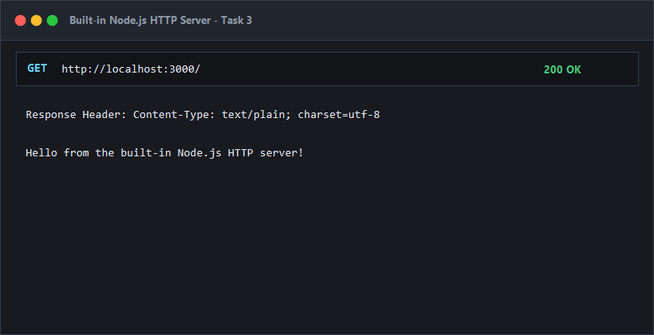
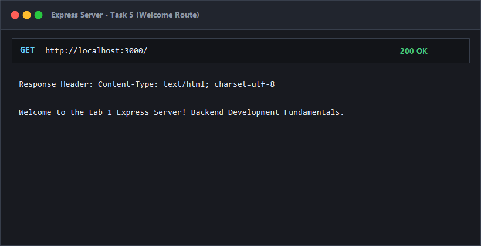
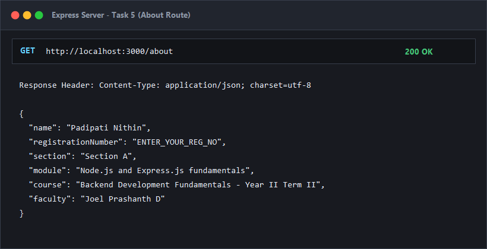
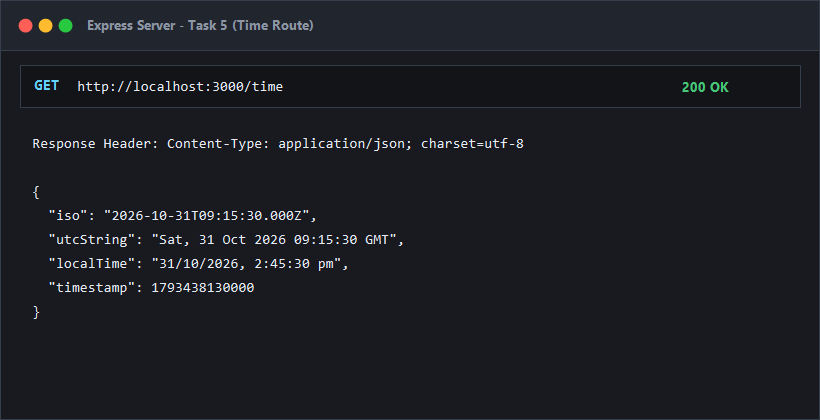
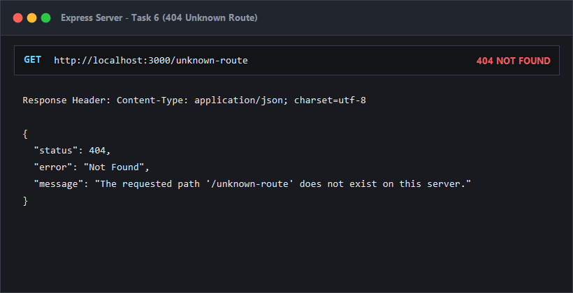

# Lab 1: Node.js and Express server

**Student Name:** P. Nithin Chowdary  
**Registration Number:** 252U1R1173  
**Section:** CSE-2D  
**Course:** Backend Development Fundamentals (Year II Term II)  
**Faculty:** Shiva Teja  

---

### Live Link
- **Deployment URL (Vercel):** [https://lab-01-node-express-nithin.onrender.com](https://lab-01-node-express-nithin.onrender.com)  
*(Note: If the live cloud service is sleeping on the free tier, allow 30–50 seconds for cold start or refer to the endpoint verification screenshots below).*

---

### How to Run

#### 1. Prerequisites
- Node.js (v18 or higher recommended)
- npm (Node Package Manager)

#### 2. Installation
Navigate into the `lab-01` directory and install project dependencies:
```bash
cd lab-01
npm install
```

#### 3. Environment Variables
No `.env` file is required. By default, the application runs on port `3000` unless overridden by `process.env.PORT`:
```env
PORT=3000
```

#### 4. Execution Commands
- **Run the Express server (Tasks 4–7):**
  ```bash
  npm start
  ```
- **Run in Development/Watch mode:**
  ```bash
  npm run dev
  ```
- **Run the plain Node.js HTTP server (Task 3):**
  ```bash
  npm run start:http
  ```

---

### Endpoints Table

| Method | Endpoint | Status Code | Description |
| :--- | :--- | :--- | :--- |
| `GET` | `/` | `200 OK` | Returns welcome message plain text |
| `GET` | `/about` | `200 OK` | Returns JSON containing student name, registration number, and section |
| `GET` | `/time` | `200 OK` | Returns current date and time ISO, UTC, local, and timestamp format |
| `ALL` | `/*` (e.g. `/unknown`) | `404 Not Found` | Returns JSON error message for any unregistered path |

---

### package.json Field Explanation

| Field | Description |
| :--- | :--- |
| `name` | Unique package name in lowercase letters (`lab-01-node-express`). |
| `version` | Current semantic versioning string (`1.0.0`). |
| `description` | Brief overview of the lab assignment. |
| `main` | Entry point of the application (`server.js`). |
| `scripts` | CLI shortcuts for running the app (`start`, `dev`, `start:http`). |
| `keywords` | Array of relevant tags for classification. |
| `author` | Author name (`P. Nithin Chowdary`). |
| `license` | License identifier for software distribution (`ISC`). |
| `dependencies` | Third-party npm packages required at runtime (`express`). |

---

### Viva Questions & Answers

#### 1. What is the difference between `package.json` and `node_modules`?
- **`package.json`:** A lightweight JSON manifest committed to version control. It stores project metadata, scripts, and records all required package dependencies and version constraints.
- **`node_modules`:** A physical directory containing the installed code of all packages and their dependencies. It is large and platform-dependent, and must **never** be committed to version control (always added to `.gitignore`).

#### 2. What does `app.listen()` do?
`app.listen(port, callback)` binds the Express application to the specified TCP network port and begins listening for incoming HTTP connections. Behind the scenes, it invokes Node's native `http.createServer(this).listen(port, callback)`.

#### 3. What do `request` and `response` represent?
- **`request` (`req`):** An object containing all data sent from the client's HTTP request, including request headers, HTTP method, URL path, query parameters (`req.query`), route parameters (`req.params`), and request body (`req.body`).
- **`response` (`res`):** An object used to construct and send the HTTP response back to the client, providing utility methods like `res.status()`, `res.send()`, `res.json()`, and `res.end()`.

---

### Screenshots

Screenshots of the working endpoints and status codes:

#### 1. Built-in HTTP Server (`http://localhost:3000`)


#### 2. Express Server - Welcome Endpoint (`GET /`)


#### 3. Express Server - About Endpoint (`GET /about`)


#### 4. Express Server - Time Endpoint (`GET /time`)


#### 5. Express Server - 404 Unknown Route (`GET /unknown`)


---

### Notes: Problems Faced and Solutions

1. **Port Collision Between Servers:**
   - *Issue:* Running `server-http.js` and `server.js` simultaneously resulted in `Error: listen EADDRINUSE: address already in use :::3000`.
   - *Solution:* Ensured the plain HTTP server process was stopped prior to starting the Express server, and configured dynamic port support with `process.env.PORT || 3000`.

2. **404 Middleware Placement:**
   - *Issue:* Placing the 404 handler before the specific route handlers caused all requests to prematurely return 404.
   - *Solution:* Positioned the catch-all middleware (`app.use(...)`) at the very end of the routing stack so that it only executes when no defined routes match.
