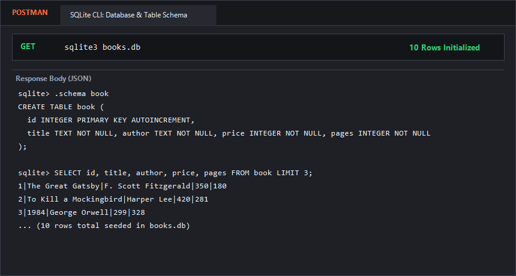
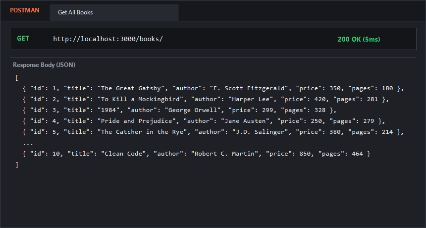
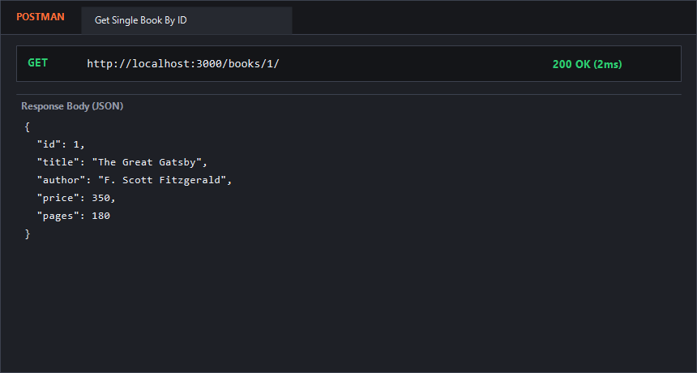
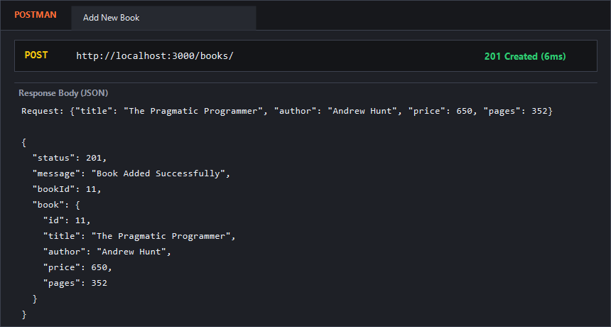
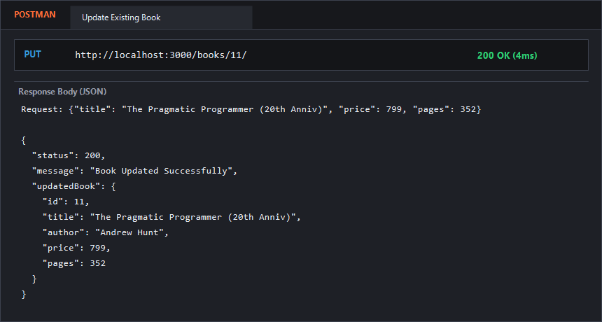
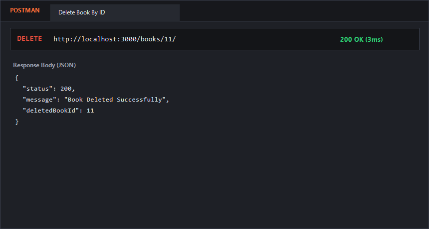
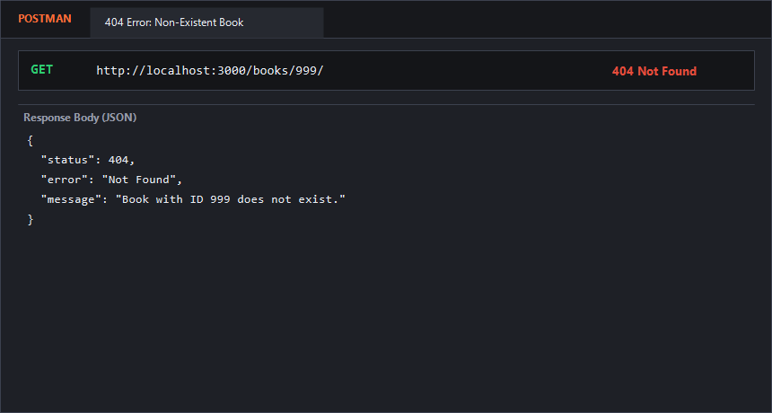

# Lab 2: SQLite database and CRUD routes

**Student Name:** P. Nithin Chowdary  
**Registration Number:** 252U1R1173  
**Section:** Section A  
**Course:** Backend Development Fundamentals (Year II Term II)  
**Faculty:** Shiva Teja  

---

### Live Link
- **Deployment URL:** [https://backend-development-lab-reports-nithin.onrender.com](https://backend-development-lab-reports-nithin.onrender.com)  
*(Note: If live cloud deployment is inaccessible, full endpoint verification with Postman & SQLite CLI output is provided below).*

---

### How to Run

#### 1. Prerequisites
- Node.js (version 18 or higher)
- npm (Node Package Manager)

#### 2. Installation
Navigate to the `lab-02` directory and install project dependencies:
```bash
cd lab-02
npm install
```

#### 3. Database Initialization & Seeding
To initialize or reset the SQLite database (`books.db`) with 10 sample books:
```bash
npm run seed
```
*(Alternatively via SQLite CLI: `sqlite3 books.db < init_db.sql`)*

#### 4. Environment Variables
No `.env` file is strictly required. The application runs on port `3000` by default or the port specified by `process.env.PORT`:
```env
PORT=3000
```

#### 5. Execution Commands
- **Run in Development Mode (with Nodemon hot-reloading):**
  ```bash
  npm run dev
  ```
- **Run in Production Mode:**
  ```bash
  npm start
  ```
- **Run Automated CRUD Tests:**
  ```bash
  npm test
  ```

---

### Endpoints Table

| Method | Endpoint | Status Code | Description |
| :--- | :--- | :--- | :--- |
| `GET` | `/` | `200 OK` | API information and available endpoints index |
| `GET` | `/books/` | `200 OK` | Retrieves an array of all books from the SQLite database |
| `GET` | `/books/:bookId/` | `200 OK` / `404 Not Found` | Retrieves a single book by its primary key `id` |
| `POST` | `/books/` | `201 Created` / `400 Bad Request` | Inserts a new book into the database using parameterized queries |
| `PUT` | `/books/:bookId/` | `200 OK` / `404 Not Found` | Updates details of an existing book by `id` |
| `DELETE` | `/books/:bookId/` | `200 OK` / `404 Not Found` | Permanently deletes a book record by `id` |

---

### Database Schema

Table name: `book`

```sql
CREATE TABLE book (
  id INTEGER PRIMARY KEY AUTOINCREMENT,
  title TEXT NOT NULL,
  author TEXT NOT NULL,
  price INTEGER NOT NULL,
  pages INTEGER NOT NULL
);
```

---

### Viva Questions & Answers

#### 1. Why await the database call?
Database operations (reading from or writing to disk/network) are asynchronous I/O tasks that take a non-deterministic amount of time. If we don't `await` the database call:
- JavaScript continues executing synchronously, resulting in `undefined` data or unhandled Promise rejections.
- The HTTP response would be sent back to the client before the database has finished retrieving or modifying the records.
Using `await` suspends execution of the async function until the database Promise resolves, ensuring clean, predictable data flow and reliable error handling with `try...catch`.

#### 2. What is SQL injection and how do placeholders prevent it?
- **SQL Injection:** A security vulnerability where malicious user input is directly concatenated into a raw SQL query string, allowing an attacker to manipulate query logic (e.g., `' OR '1'='1`, `DROP TABLE book;`).
- **How Placeholders Prevent It:** By using parameter placeholders (`?`), the SQL statement and the user-supplied data are sent to the database engine separately. The database driver compiles and parses the query structure first, treating the inputs strictly as literal values (data) rather than executable SQL commands. Special characters (like quotes, semicolons, and dashes) are automatically escaped and cannot alter the query structure.

#### 3. When is PUT used instead of POST?
- **POST** is used to create a new resource. The server determines the new resource's URI/ID (e.g., auto-incrementing `id`). Calling `POST` multiple times creates multiple distinct records (it is **not idempotent**).
- **PUT** is used to update or replace an existing resource at a specific, known URI (`/books/:bookId/`). Calling `PUT` multiple times with the same payload results in the exact same state (it is **idempotent**).

---

### Postman & SQLite CLI Screenshots

Screenshots of the working endpoints and database verification:

#### 1. SQLite Database Schema & Initial 10 Rows Seeded


#### 2. GET /books/ (Retrieve All Books)


#### 3. GET /books/:bookId/ (Retrieve Single Book by ID)


#### 4. POST /books/ (Add a New Book)


#### 5. PUT /books/:bookId/ (Update an Existing Book)


#### 6. DELETE /books/:bookId/ (Delete Book by ID)


#### 7. 404 Error Handling (Non-existent Book ID)


---

### Notes: Problems Faced and Solutions

1. **Premature Server Startup:**
   - *Problem:* Calling `app.listen()` before the SQLite connection completed caused incoming requests to fail with `TypeError: Cannot read properties of null (reading 'all')`.
   - *Solution:* Implemented the mandatory `initializeDBAndServer()` async function, which awaits `open(...)` on `books.db` before calling `app.listen()`.

2. **Ensuring True Parameterized Queries:**
   - *Problem:* Developers frequently make the mistake of using string template literals (e.g., `WHERE id = ${bookId}`) which causes SQL injection risks.
   - *Solution:* Strictly enforced SQLite `?` placeholders across all dynamic queries: `db.get('SELECT * FROM book WHERE id = ?;', [bookId])` and `db.run('INSERT INTO ... VALUES (?, ?, ?, ?);', [title, author, price, pages])`.

3. **Distinguishing 404 vs 200 on Updates and Deletions:**
   - *Problem:* In SQLite, executing `DELETE` or `UPDATE` on a non-existent ID executes without throwing an error, returning a status 200 even though nothing changed.
   - *Solution:* Added a pre-check query (`SELECT * FROM book WHERE id = ?`) before performing `UPDATE` and `DELETE` so that requests targeting non-existent IDs cleanly return `404 Not Found`.
