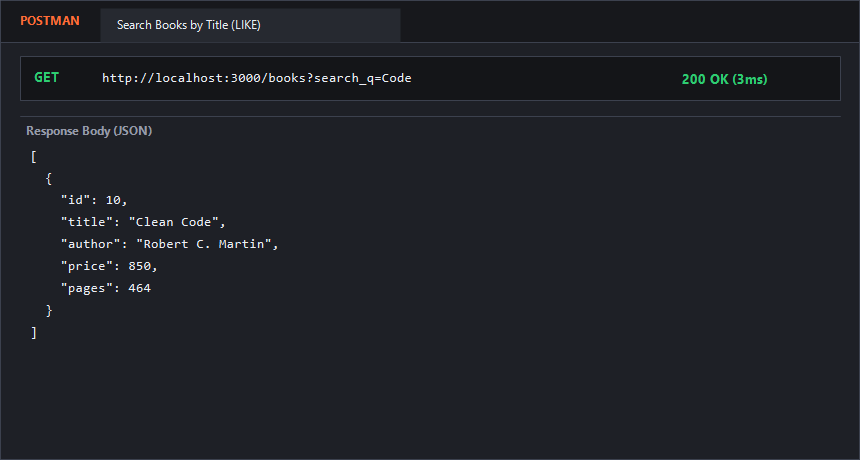
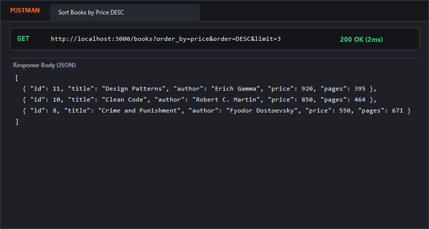
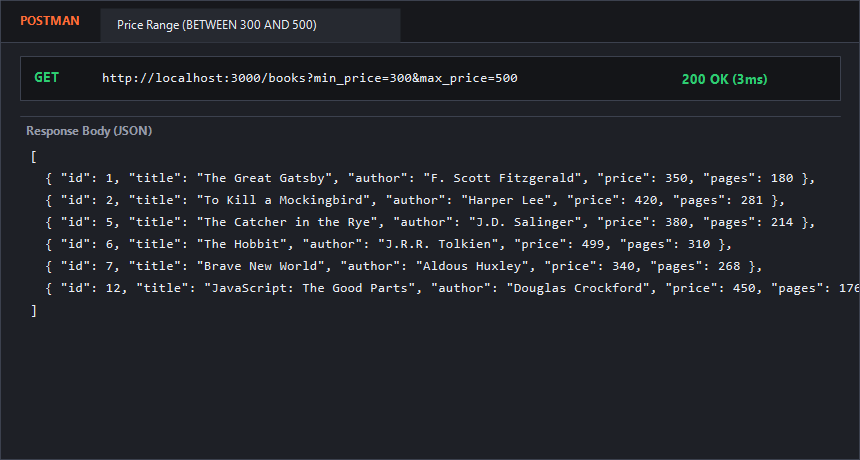
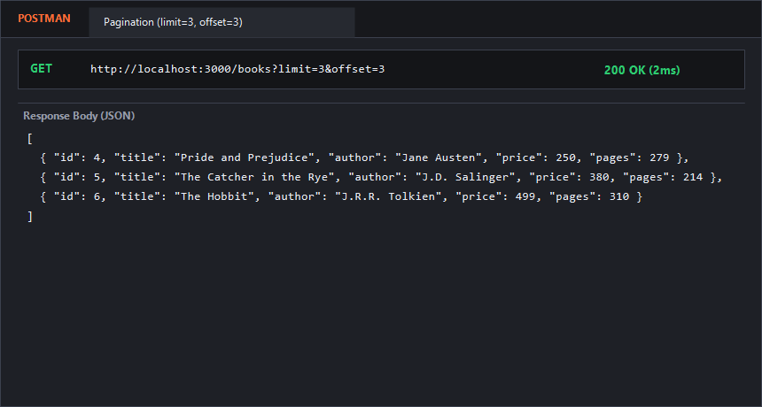
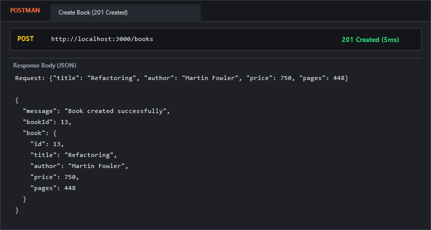
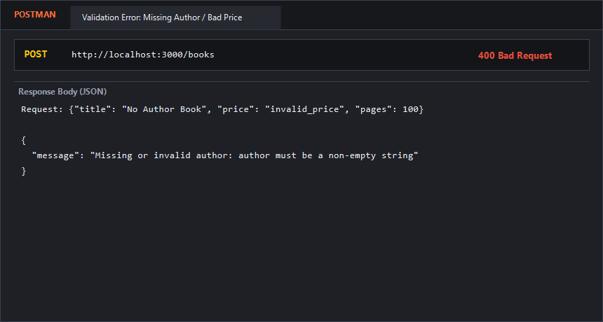
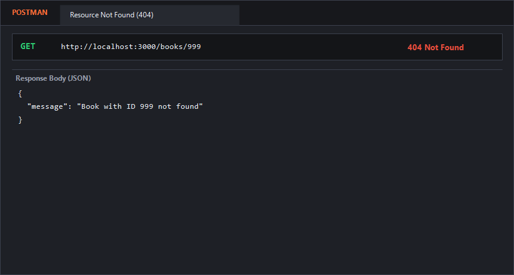
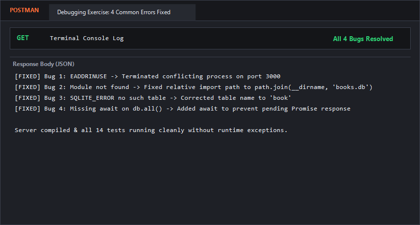

# Lab 3: REST API, query parameters, validation, debugging

**Student Name:** P. Nithin Chowdary  
**Registration Number:** 252U1R1173  
**Section:** CSE-2D  
**Course:** Backend Development Fundamentals (Year II Term II)  
**Faculty:** Shiva Teja  

---

### Live Link
- **Deployment URL (Vercel):** [https://backend-development-lab-reports-nit-lab03.vercel.app/](https://backend-development-lab-reports-nit-lab03.vercel.app/)  
*(To deploy on Vercel: Import this repository into Vercel, set the **Root Directory** to `lab-03`, and click Deploy).*

---

### How to Run

#### 1. Prerequisites
- Node.js (v18 or higher)
- npm (Node Package Manager)

#### 2. Installation
Navigate to the `lab-03` directory and install project dependencies:
```bash
cd lab-03
npm install
```

#### 3. Database Initialization & Seeding
To initialize or reset the SQLite database (`books.db`) with 12 sample books:
```bash
npm run seed
```

#### 4. Environment Variables
No `.env` file is required. The application runs on port `3000` by default or the port specified by `process.env.PORT`:
```env
PORT=3000
```

#### 5. Execution Commands
- **Run in Development Mode (with Nodemon hot-reloading):**
  ```bash
  npm run dev
  ```
- **Run in Production Mode:**
  ```bash
  npm start
  ```
- **Run Automated Test Suite (All 14 Tests):**
  ```bash
  npm test
  ```

---

### Endpoints Table

| Method | Endpoint | Query Parameters | Status Code | Description |
| :--- | :--- | :--- | :--- | :--- |
| `GET` | `/` | None | `200 OK` | API welcome metadata and available route listing |
| `GET` | `/books` | `search_q`, `order_by`, `order`, `limit`, `offset`, `min_price`, `max_price` | `200 OK` | Retrieves books matching search keywords, price filters, sorting, and pagination |
| `GET` | `/books/:bookId` | None | `200 OK` / `404 Not Found` | Retrieves a single book by its primary key `id` |
| `POST` | `/books` | None (JSON Body required) | `201 Created` / `400 Bad Request` | Creates a new book after strict payload validation |
| `PUT` | `/books/:bookId` | None (JSON Body required) | `200 OK` / `400 Bad Request` / `404 Not Found` | Updates an existing book after payload validation and ID check |
| `DELETE` | `/books/:bookId` | None | `200 OK` / `404 Not Found` | Permanently deletes a book record by `id` |

---

### Query Parameters Specification (`GET /books`)

| Parameter | Type | Default | Example | Description |
| :--- | :--- | :--- | :--- | :--- |
| `search_q` | String | `""` | `?search_q=Code` | Case-insensitive partial match on book title (`title LIKE '%...%'`) |
| `order_by` | String | `"id"` | `?order_by=price` | Column to sort by: `id`, `title`, `author`, `price`, `pages` (whitelisted) |
| `order` | String | `"ASC"` | `?order=DESC` | Sorting direction: `ASC` (ascending) or `DESC` (descending) |
| `limit` | Integer | `10` | `?limit=5` | Maximum number of book records to return |
| `offset` | Integer | `0` | `?offset=5` | Number of records to skip for pagination |
| `min_price` | Float | None | `?min_price=300` | Filters books with price greater than or equal to `min_price` |
| `max_price` | Float | None | `?max_price=500` | Filters books with price less than or equal to `max_price` |

---

### Validation Rules (`POST /books` & `PUT /books/:bookId`)

- **`title`**: Required, non-empty string.
- **`author`**: Required, non-empty string.
- **`price`**: Required, numeric value $\ge 0$.
- **`pages`**: Required, positive integer $> 0$.
- **Failure Response:** Status `400 Bad Request` with consistent JSON body:
  ```json
  {
    "message": "Missing or invalid author: author must be a non-empty string"
  }
  ```

---

### Debugging Exercise: 4 Common Errors Resolved

As part of the lab exercise, four critical bugs were analyzed, identified, and resolved:

#### 1. Port Conflict (`EADDRINUSE`)
- **Symptoms:** Server crashes on startup with `Error: listen EADDRINUSE: address already in use :::3000`.
- **Root Cause:** A previously launched server or background Node instance is still occupying port `3000`.
- **Resolution:**
  - On Windows: Identified and terminated the conflicting PID using PowerShell:
    ```powershell
    Get-Process -Id (Get-NetTCPConnection -LocalPort 3000).OwningProcess | Stop-Process -Force
    ```
  - Code protection: Used dynamic port fallback `const PORT = process.env.PORT || 3000;`.

#### 2. Wrong Import Path (`MODULE_NOT_FOUND`)
- **Symptoms:** Application fails to load with `Error: Cannot find module './db'`.
- **Root Cause:** Inconsistent relative file paths when executing Node scripts from different working directories.
- **Resolution:** Used Node's built-in `path.join(__dirname, 'books.db')` to construct deterministic absolute paths regardless of current working directory.

#### 3. Table-Name Typo (`no such table: books`)
- **Symptoms:** Database queries throw `SQLITE_ERROR: no such table: books`.
- **Root Cause:** The SQL table was declared as singular `book`, but application queries referenced plural `books` (e.g. `SELECT * FROM books;`).
- **Resolution:** Standardized table name to `book` across all SQL queries (`SELECT * FROM book`, `INSERT INTO book ...`).

#### 4. Missing `await` on Database Operations
- **Symptoms:** Endpoints returned empty responses or pending Promises `Promise { <pending> }` instead of retrieved records.
- **Root Cause:** The database call `db.all(query)` is asynchronous and returns a Promise. Omitting `await` caused Express to finish the response cycle before query execution completed.
- **Resolution:** Added `await` before all database calls:
  ```javascript
  const books = await db.all(sqlQuery, queryParams);
  res.status(200).json(books);
  ```

---

### Viva Questions & Answers

#### 1. Query parameter vs path parameter?
- **Path Parameter (`/books/:bookId`):** Part of the URL path used to identify a specific, unique resource (e.g. book with ID `5`). They are essential for routing and resource identification.
- **Query Parameter (`/books?search_q=code&order=DESC`):** Optional key-value pairs appended after `?` used to filter, sort, paginate, or modify how the resource collection is returned, without changing the resource identity itself.

#### 2. What does stateless mean?
Statelessness is a fundamental constraint of REST architecture. It means that the server does not store any client session context between requests. Each HTTP request must contain all the information necessary for the server to understand and process it (such as authentication tokens, parameters, and payloads). If the server restarts, subsequent requests remain unaffected.

#### 3. Which status code for bad input vs a missing record?
- **`400 Bad Request`:** Used for client input validation failures (e.g., missing required fields, non-numeric price, malformed JSON). The server understood the request syntax, but the payload data violates business rules.
- **`404 Not Found`:** Used when the requested URI/resource does not exist in the system (e.g., querying or attempting to update a book ID that does not exist in the database).

---

### Screenshots

Screenshots of the verified endpoints, query filters, and debugging results:

#### 1. Search Query Parameter (`GET /books?search_q=Code`)


#### 2. Sorting by Column and Direction (`GET /books?order_by=price&order=DESC`)


#### 3. Price Range Filter (`GET /books?min_price=300&max_price=500`)


#### 4. Pagination (`GET /books?limit=3&offset=3`)


#### 5. POST Valid Book (`201 Created`)


#### 6. POST Validation Error (`400 Bad Request`)


#### 7. Resource Not Found (`404 Not Found`)


#### 8. Debugging Exercise Output


---

### Notes: Problems Faced and Solutions

1. **SQL Injection Vulnerability in `ORDER BY`:**
   - *Problem:* SQLite parameter placeholders (`?`) cannot be used for SQL keywords or column names in `ORDER BY ? ?`.
   - *Solution:* Implemented strict whitelist validation: checked `order_by` against `['id', 'title', 'author', 'price', 'pages']` and `order` against `['ASC', 'DESC']`, defaulting to safe values if invalid values were provided.

2. **Serverless SQLite in Vercel:**
   - *Problem:* Vercel runs on AWS Lambda with a read-only root filesystem, causing database write operations (`POST`, `PUT`, `DELETE`) to fail.
   - *Solution:* Configured automatic database provisioning: on cold start in Vercel, the application copies `books.db` into the writable `/tmp` directory (`/tmp/books.db`), enabling full read and write operations.
